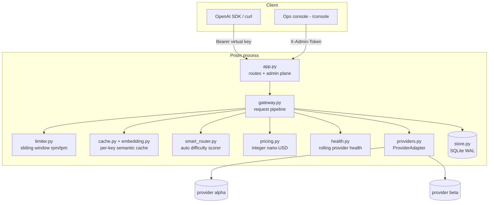
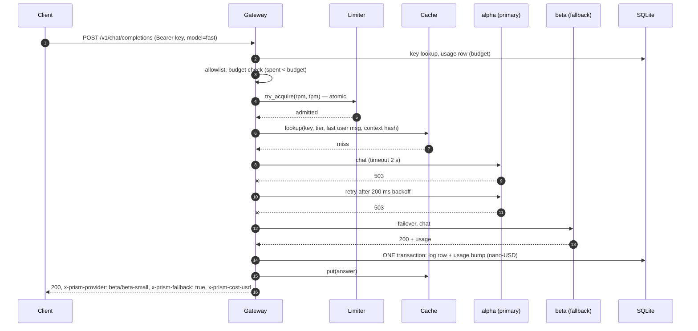
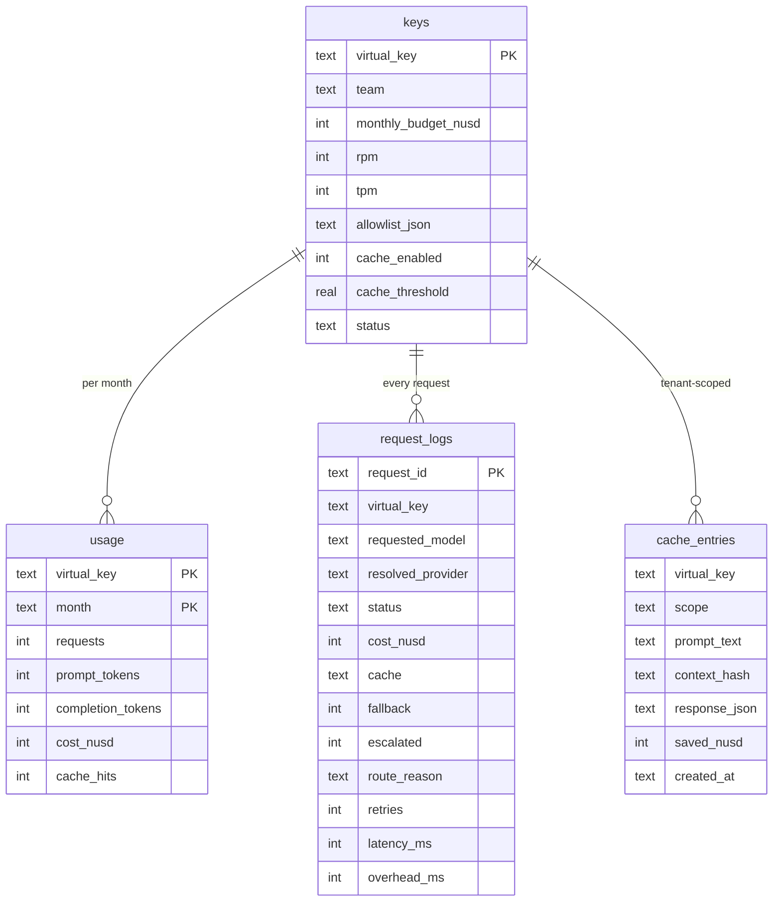

# Architecture

Prism is a single async process (Starlette on one uvicorn worker) in front of N OpenAI-compatible providers. State lives in SQLite (WAL); the rate-limit windows live in process memory. One worker is deliberate: it is what makes the in-memory limiter and the check-and-consume critical section correct.

## Components

## Request lifecycle (non-streaming, cache miss, failover)

## Check order and why

1. **Auth** (401) — nothing else is meaningful without a tenant.
2. **Body validation** (400) and **model resolution** (404) — cheap, no state touched.
3. **Allowlist** (403) — a policy decision independent of load.
4. **Budget** (402) — one primary-key read of the `(key, month)` row; never a log scan.
5. **Rate limit** (429) — *after* budget, so an over-budget key cannot burn quota; the slot is consumed atomically.
6. **`auto` classification** — only for admitted requests.
7. **Cache** — a hit costs `$0` and skips the upstream entirely.
8. **Upstream** — timeout per attempt, retry / failover policy below.
9. **Meter + log** — one transaction.

## Failure matrix

| Upstream outcome | Retry same provider | Fail over | Client sees |
|---|---|---|---|
| 5xx / connection error / malformed 200 | up to 3 attempts, 200 ms × 2ⁿ | yes | 200 from fallback, or 502 if chain exhausted |
| Timeout (2 s default) | **no** | immediately | 200 from fallback, or 502 |
| Provider 429 | no | immediately | same |
| Other 4xx | no | yes (likely per-provider config) | same |
| Failure **before** first stream chunk | as above | yes | clean stream from fallback |
| Failure **after** first stream chunk | no | **no** (never splice) | SSE `error` event (`stream_interrupted`), stream ends **without** `[DONE]` |
| Client disconnects mid-stream | — | — | logged as `stream_aborted` |

## Data model (SQLite)

*(Column names are simplified for the diagram; `prism/store.py` is the source of truth.)*

## Key design choices, in one line each

- **Money is an integer** (nano-USD) end-to-end, so the header, the log and the usage API can never disagree by rounding.
- **Check-and-consume in one critical section with no `await`**, so a burst cannot over-admit.
- **Cache is isolated by construction** — lookups never iterate other tenants' entries — not by a filter that could be forgotten.
- **Streams are never spliced.** A truncated answer must never look complete.
- **The gateway talks to an interface** (`ProviderAdapter`); tests drive the real pipeline through an in-process fake, which is how failure modes are tested deterministically.
- **Classify the task, not the prompt**: the router scores only the instruction sentences, so pasted context cannot inflate difficulty.

## Extending

| To add… | Touch |
|---|---|
| A real provider (OpenAI, Anthropic-compat proxy, Ollama) | add it to the gateway config JSON; set `PRISM_PROVIDER_<NAME>_API_KEY` / `_BASE_URL`; raise `PRISM_UPSTREAM_TIMEOUT_MS` |
| A neural embedder | implement the one-method `Embedder` protocol in `embedding.py` |
| Shared rate limiting | replace `SlidingWindowLimiter` with a Redis-Lua implementation of the same `try_acquire` / `adjust` interface |
| A new pricing entry | `data/model_pricing.json` |
